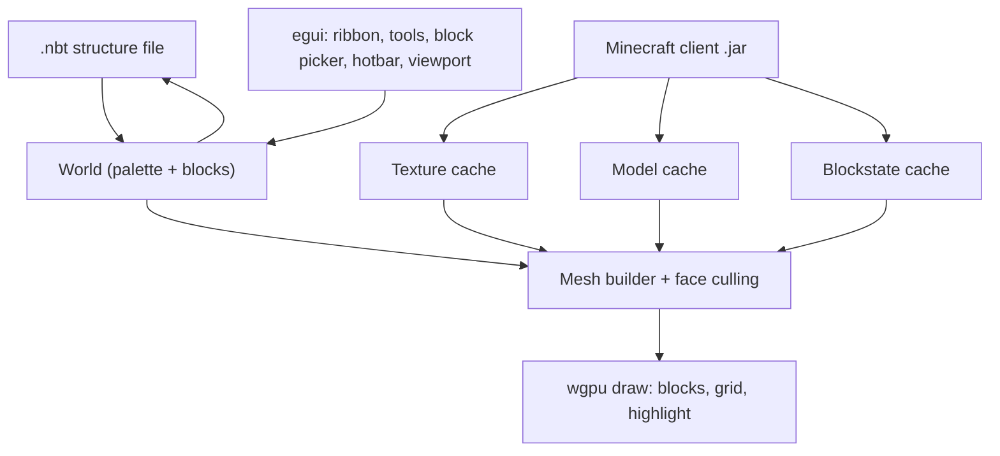

# Implementation Plan: Minecraft Create Mod NBT Editor

A GUI application that reads, renders, edits and exports Minecraft structure NBT files. Rust, with
`egui` for the UI and `wgpu` for the 3D viewport.

---

## 1. System Architecture



---

## 2. Data Layers

| Layer | Contents |
| --- | --- |
| NBT structure | `size`, `palette` (`Name` + `Properties`), `blocks` (`pos` + `state` palette index + optional block entity `nbt`) |
| Asset blockstates | Blockstate JSONs from the jar: for each block, the models each of its states draws |
| Asset models | Model JSONs from the jar: cuboid elements (0-16 coordinates) and texture slots, with `parent` inheritance |
| Render mesh | Vertex/index buffers and a 2D texture array, one layer per distinct texture |

A palette entry is looked up by the stem of its `Name` (`minecraft:quartz_pillar` → `quartz_pillar`)
in the blockstate cache, which names the models its `Properties` select (4.2).

---

## 3. Texture Storage

Imported once from a client `.jar` (the only supported source) and read back on demand.

*   **Extraction.** Entries matching `assets/{namespace}/textures/block/{file}.{png|bmp|jpg}` are
    written to `./texture_cache/` under their original name.
*   **Entity tiles.** These `assets/{namespace}/textures/{path}.png` entries are entity atlases.
    Each is cut into one file per unwrapped box face, the face at the top-left of a 16x16 square,
    one texel per model unit. A file wider than its layout is the layout scaled up, and so are its
    tiles.

    | Path | Layout | Key |
    | --- | --- | --- |
    | `entity/chest/{file}` | 64 | `chest_{file}_{base\|lid\|lock}_{face}` |
    | `entity/bed/{colour}` | 64 | `bed_{colour}_{part}_{face}` |
    | `entity/conduit/base` | 32 | `conduit_base_shell_{face}` |
    | `entity/skeleton/skeleton`, `entity/skeleton/wither_skeleton`, `entity/zombie/zombie`, `entity/creeper/creeper`, `entity/piglin/piglin`, `entity/player/wide/steve` or `entity/steve` | 64 | `head_{file}_{part}_{face}` |
    | `entity/enderdragon/dragon` | 256 | `head_dragon_{part}_{face}` |

    `{face}` is the face as unwrapped in the atlas (`ModelPart` order), not the side it is drawn on.
*   **Key.** The file stem (`glass`). One key, one file.
*   **Record.** `Texture { file_name, format, has_alpha }`. `has_alpha` is set at extraction if any
    pixel has alpha below 255; `bmp` and `jpg` are always `false`.
*   **Manifest.** `./_textures.cache.json`, key → record. Loaded at startup; missing or invalid
    means an empty library until a jar is imported.
*   **Query.** `TextureLibrary::get(key)` returns decoded pixels, memoised. An unknown key or
    unreadable file logs a warning and returns `./assets/image-missing.png`.
*   **Modules** (`src/textures/`): `texture.rs` (record, format), `library.rs` (dictionary, manifest,
    queries). Extraction: `src/import/jar/textures.rs`.

`texture_cache/` and the manifest are gitignored.

---

## 4. Model Storage

Imported from the same jar walk as textures.

*   **Extraction.** Entries matching `assets/{namespace}/models/block/{file}.json` (no nested paths)
    are written to `./model_cache/`.
*   **Key.** The file stem (`quartz_pillar`). Every id inside a model (parents, textures) is reduced
    to its stem at extraction.
*   **Record.** `BlockModel { file_name, parent, textures, elements_from }`:
    *   `parent`: parent model stem, `None` for roots.
    *   `textures`: slot → texture key or `#slot` indirection, as declared.
    *   `elements_from`: stem of the nearest model in the chain that declares `elements`; `None`
        when the chain has no geometry. Computed in a second pass after the walk.
*   **Manifest.** `./_models.cache.json`, key → record, slot order stable.

```json
{
  "quartz_pillar": {
    "file_name": "quartz_pillar.json",
    "parent": "cube_column",
    "textures": { "end": "quartz_pillar_top", "side": "quartz_pillar" },
    "elements_from": "cube"
  },
  "chest": {
    "file_name": "chest.json",
    "parent": null,
    "textures": { "particle": "oak_planks" },
    "elements_from": null
  }
}
```

*   **Reload.** The manifest is reloaded when its modification time changes, except during a jar
    import.
*   **Modules** (`src/block_models/`): `block_model.rs` (record), `model_json.rs` (serde types),
    `library.rs` (dictionary, manifest, resolution). Extraction: `src/import/jar/models.rs`.

`model_cache/` and the manifest are gitignored.

### 4.1. Resolution

`ModelLibrary::resolve(name, properties)` returns a `ResolvedBlock`, memoised per (name, properties):

1. Look up the name's stem in the blockstate cache and select the models for the properties
   (4.2). Each selected model becomes one part, with the blockstate's `x`, `y` and `uvlock`.
2. A block with no definition uses the model of the same name. Wall signs then map to the
   standing sign's model and every banner to `banner` when they have no model of their own.
3. Per part, walk the parent chain (depth cap 32), merging texture dictionaries child-first and
   following `#slot` indirections. An unresolved slot is left empty and draws the missing texture.
4. Read the elements from `elements_from` and bind each face's texture to a `TextureLibrary` key.
   No `elements_from` marks the part as a block entity.
5. An unknown model or a chain over the depth cap logs a warning and makes that part a full cube
   with the missing texture on every face.

### 4.2. Blockstates

*   **Extraction.** Entries matching `assets/{namespace}/blockstates/{file}.json`.
*   **Key.** The file stem, which is the block name without its namespace (`redstone_wire`).
*   **Record.** `BlockDefinition`, with model ids reduced to stems and weighted model lists reduced
    to their first entry:
    *   `Variants`: a list of `{ properties, apply }`. One model per state.
    *   `Multipart`: a list of `{ when, apply }`. `when` is a property test (each property against
        a list of allowed values), `Or`, `And`, or absent.
    *   `apply`: `{ model, x, y, uvlock }`.
*   **Manifest.** `./_blockstates.cache.json`, key → record. Gitignored. Reloaded when its
    modification time changes.
*   **Selection.**
    *   `Variants`: the first variant whose properties all match. A state that matches none takes
        the first variant it does not contradict, an unrotated one if there is one.
    *   `Multipart`: every case whose `when` holds or is absent. No case means nothing is drawn.
*   **States of a block.** `Variants`: one per variant. `Multipart`: every combination of the
    values its conditions test. Booleans, wall heights (`none`/`low`/`tall`), wire sides
    (`none`/`side`/`up`) and bamboo leaves (`none`/`small`/`large`) are completed to their full
    set. At most `Config::MAX_BLOCK_VARIANTS` (1024).
*   **Module:** `src/block_models/block_definition.rs`.

Caches imported before blockstates were kept have no definitions: every block then uses the model
of the same name, and the picker lists model stems. The ribbon then shows a notice to set the jar
again.

---

## 5. Drawing Blocks

### 5.1. Types

| File | Contents |
| --- | --- |
| `models/block.rs` | `Face`, `Block`, `BlockPart`, `BasicBlock`, `FACE_CORNERS` |
| `models/block_type.rs` | `BlockType` |
| `models/element.rs` | `Element`, `ElementFace`, `ElementRotation`, `StateRotation`, tint table |
| `models/sign.rs`, `models/banner.rs`, `models/chest.rs`, `models/bell.rs`, `models/head.rs`, `models/bed.rs`, `models/conduit.rs` | Hand-built geometry for signs, banners, chests, bells, mob heads, beds and the conduit |
| `models/entity_model.rs` | `ModelBox`, `Placement`: vanilla entity-model boxes placed in block space; entity atlas tiles |
| `custom_block_keys.rs` | `CustomBlockKey`: every block key with behaviour its model does not describe |
| `rendering/block_mesh.rs` | `BlockVertex`, face emission |
| `rendering/blocks.rs` | Mesh build from the world, texture array, block pipeline |
| `rendering/visibility.rs` | Neighbour and cavity culling |
| `rendering/grid.rs`, `grid_mesh.rs` | Reference grid and world axes |
| `rendering/highlight.rs` | Placement-target face overlay |

A `Block` is one palette entry: `name`, `properties`, `block_type`, `parts` and the chain's
`particle_texture`. A `BlockPart` is one model's `elements` plus a `StateRotation` and `uvlock`.

`BlockType::classify` decides in this order:

| Type | Condition | Drawn as |
| --- | --- | --- |
| `Invisible` | air, cave_air, void_air, barrier, structure_void, light | nothing |
| `Sign(SignKind)` | no geometry, `*_sign` / `*_wall_sign` / `*_hanging_sign` / `*_wall_hanging_sign` | hand-built boxes |
| `Banner(BannerKind)` | no geometry, `*_banner` / `*_wall_banner` | hand-built boxes |
| `Chest(ChestKind)` | no geometry, `chest` / `trapped_chest` / `ender_chest` | hand-built boxes |
| `Head(HeadKind)` | no geometry, a mob head or skull, floor or wall | hand-built boxes |
| `Bed` | no geometry, `*_bed` | hand-built boxes |
| `Conduit` | no geometry, `conduit` | hand-built box |
| `BlockEntity` | any other block with no geometry | inset placeholder cube |
| `Basic(BasicBlock)` | parent `cube_all` or `cube_column`, no property rotation | full-cube fast path |
| `Elements` | everything else | element list |

### 5.2. Coordinates

| Face | Axis | Plane |
| --- | --- | --- |
| `Down` | -Y | `y = 0` |
| `Up` | +Y | `y = 1` |
| `North` | -Z | `z = 0` |
| `South` | +Z | `z = 1` |
| `West` | -X | `x = 0` |
| `East` | +X | `x = 1` |

*   One block is one world unit. NBT position `[x, y, z]` occupies `[x, x+1] × [y, y+1] × [z, z+1]`.
*   Model coordinates are 0-16 (allowed -16 to 32) and are divided by 16.
*   Corners wind counter-clockwise from outside; back faces are culled on the GPU.
*   UV `v = 0` is the top of the texture.

### 5.3. Basic Blocks

One full-cube element, six faces, full-texture UVs.

| `BasicBlock` | Parent | `down` / `up` slot | side slot |
| --- | --- | --- | --- |
| `All` | `cube_all` | `all` | `all` |
| `Column` | `cube_column` | `end` | `side` |

Each face emits the four `FACE_CORNERS` corners and two triangles: 24 vertices, 36 indices per cube.

### 5.4. Elements

An element is a box `from`–`to` with an optional rotation, up to six faces, and a `shade` flag.

*   **Rotation.** One axis, angle in {-45, -22.5, 0, 22.5, 45}, about `origin`. `rescale` scales the
    two perpendicular axes by `1 / cos(angle)`.
*   **Planes.** An axis where `from == to` emits only the two faces in that plane.
*   **Faces.** An absent face is not drawn.

### 5.5. Faces

`ElementFace { texture, uv, uv_rotation, cullface, tint_index }`.

*   `uv` defaults to the element bounds projected onto the face. Reversed rectangles mirror the
    texture.
*   `uv_rotation` is 0, 90, 180 or 270.
*   Tint comes from a fixed table by `CustomBlockKey`: grass green, foliage green, water blue,
    redstone by `power`, melon and pumpkin stems by `age`, otherwise white.
*   Shading is multiplied into the vertex colour: `Down` 0.5, `Up` 1.0, `North`/`South` 0.8,
    `West`/`East` 0.6, or 1.0 with `shade: false`.

`BlockVertex { position, uv, layer, color }`.

### 5.6. Palette Property Transforms

A part's `StateRotation { x, y }` (90° steps) and `uvlock` come from its blockstate (4.2).

When the block's definition reads neither `axis` nor `facing`, or the block has no definition,
those properties turn every part instead:

| Property | Rotation |
| --- | --- |
| `axis=x` | x 90, y 90 |
| `axis=z` | x 90 |
| `facing=up` | none |
| `facing=down` | x 180 |
| `facing=north` / `east` / `south` / `west` | x 90, then y 0 / 90 / 180 / 270 |

`facing` turns the block so its top points that way and its bottom rests on the opposite side.

It is applied about the block centre `(8, 8, 8)`, X then Y, after element rotation. X 90 turns
north to down and up to north; Y 90 turns north to east. A rotated part
culls against the rotated `cullface` direction. `uvlock` counter-rotates `Up`/`Down` UVs by the Y
rotation. A `Basic` block with a non-identity rotation is drawn as `Elements`, as is a block of
more than one part.

### 5.7. Blocks Without Geometry

*   `BlockEntity`: a cube inset by 1/16 on every side, textured with the `particle` texture.
*   `Sign`: board and post, wall board, or hanging board on chains, from the `particle` texture,
    turned by `rotation` (22.5° steps) or `facing`. Text is not drawn.
*   `Banner`: pole, crossbar and flag. Wood uses `particle`; the flag uses `<colour>_wool`. Patterns
    are not drawn.
*   `Chest`: base, lid and lock, closed, turned by `facing`. Faces use the chest tiles (3) of the
    `normal`, `trapped` or `ender` atlas. `type=left` / `right` use the `_left` / `_right` atlas
    and reach the shared side of the cell; `ender_chest` is always single.

*   `Head`: the mob's vanilla head model from its entity texture (3): an 8x8x8 head; zombie and
    player add a hat layer 0.25 larger; piglin is a 10x8x8 head with snout and tusks, without
    ears; the dragon is upper head, upper lip, closed jaw, scales and nostrils at 3/4 scale, with
    the snout reaching outside the cell. A floor head stands on the floor, its face north at
    `rotation=0`, turned clockwise from above in 22.5° steps. A wall head is a quarter block up,
    against the wall opposite `facing`, its face towards `facing`. Player heads show the default
    skin.
*   `Bed`: the half named by `part`, a 16x16x6 mattress 3 to 9 units up with two 3x3x3 legs at its
    far end, from the colour's bed atlas. The head half's pillow points `facing`. The mattress
    end each half shares with the other is not drawn.
*   `Conduit`: an inactive conduit's 6x6x6 shell at the centre of the cell, from the `base` atlas.

Entity-model boxes are placed as vanilla's renderer places them, Y down in the model, and each
face draws the tile of the unwrapped face that lands there, with the UV orientation and rotation
vanilla's `ModelPart` gives it.

`bell` has geometry for its frame only. Its body (6x7x6) and lip (8x2x8) are added as a further
part, unrotated, from the `bell_top`, `bell_side` and `bell_bottom` textures.

### 5.8. Textures on the GPU

*   A 2D texture array, `Config::TEXTURE_SIZE` (16) square, one layer per distinct texture key.
    Layer 0 is the missing texture.
*   Animation strips (taller than wide) use the first frame. Larger images are resampled.
*   One draw pass; fragments with alpha below 0.1 are discarded.

### 5.9. Mesh Assembly

Each palette entry in use is resolved once into a `Block`. Its texture keys are assigned layers,
then every cell referring to it emits its faces through the culling tests. The mesh is rebuilt
when the world is marked dirty.

### 5.10. Face Culling

*   **Neighbour.** A face with a `cullface`, or one spanning a whole side of its cell, is skipped
    when the neighbour on that side fully covers the shared face with an opaque texture.
*   **Cavity.** Open space is flood-filled from outside the structure's bounding box. Faces facing
    only unreached space, and geometry inside it, are skipped. Limited to
    `Config::MAX_CAVITY_FLOOD_CELLS`; larger structures use neighbour culling only.
*   `Block::occlusion_mask` gives the sides a block fully hides. `Invisible`, `BlockEntity`, `Sign`,
    `Banner`, `Chest`, `Head`, `Bed` and `Conduit` hide nothing.

---

## 6. Editing

### 6.1. Placement

The cursor ray hits the nearest block face, or the ground plane (`y = 0`), treated as the `Up` face
of the cell below. The hit face is highlighted (`Config::HIGHLIGHT_COLOR`) while the Place tool is
active.

*   **E** toggles facing mode. While it is on, the highlight uses `Config::HIGHLIGHT_FACING_COLOR`.
    E is ignored while a text field has keyboard focus.
*   **Click** places the selected block in the empty cell outside the highlighted face: in its
    current variant (6.5), or with facing mode on, with `facing` also set to the hit face.
*   **Right click** removes the highlighted block.

### 6.2. Undo

Each edit is a `Transaction`. `History` applies it, keeps the last `Config::undo_history_limit()`
(default 100), and Ctrl+Z undoes the newest.

| Transaction | Apply | Undo |
| --- | --- | --- |
| `PlaceBlock` | Place a block state in an empty cell | Remove it, if the cell still holds that state |
| `PlaceBlockFacing` | `PlaceBlock` with `facing` set to the hit face | Same as `PlaceBlock` |

Right-click removal is not recorded.

### 6.3. World Storage

The world mirrors the structure file:

*   **Palette.** `Vec<BlockState { name, properties }>`, matching NBT `Name` and `Properties`.
    Names are namespaced; a picker stem without one gets `minecraft:`. The default state has no
    properties. Entries are only appended, so indices are stable. Unused entries are dropped on
    export.
*   **Blocks.** Cell → palette index (`state`).

### 6.4. Import

**File → Import NBT** reads a structure `.nbt` file (gzipped or raw) with `fastnbt` and replaces
the world with it.

*   `palette` is taken as written, so `state` indices match the file. A file with `palettes`
    instead uses its first variant.
*   Each `blocks` entry sets its `pos` cell to its `state`. Cells of `minecraft:air`, `cave_air`
    and `void_air` are left empty.
*   `size`, `entities`, `DataVersion` and block entity `nbt` are not read.
*   The undo history is cleared and the camera frames the imported blocks.
*   A file that fails to parse, a `pos` without three values, or a `state` outside the palette
    logs an error and leaves the world unchanged.
*   **Module:** `src/import/nbt.rs`.

### 6.5. Block Picker and Variants

*   The right panel lists each block once, by blockstate key, whatever its variants.
*   Selecting a block lists its states (4.2) and starts on an unrotated variant, or for a
    multipart block the first combination that draws a model.
*   Properties hand-built geometry reads but the blockstate file does not list multiply the
    states, default value first: beds list `part=foot` and `part=head`.
*   **Tab** moves to the next variant and **Shift+Tab** to the previous, wrapping. Both are
    ignored while a text field has keyboard focus.
*   The hotbar shows the block, the current variant and its position (`3/40`) on the left, and
    the previous and next variants on the right.
*   A click places `BlockState { name, properties }` with the current variant's properties.

---

## 7. Implementation Phases

### Phase 1: Core Data

NBT parsing (`fastnbt`), texture and model caches, model resolution, world storage.

### Phase 2: Rendering

wgpu pipelines, mesh builder with culling, raycast face highlight.

### Phase 3: Editor

egui panels (tools, block picker, properties, hotbar) and commands: placement, deletion, selection,
translation, rotation, and line, cuboid and cylinder placement.

### Phase 4: Import and Export

### Phase 5: Re-usable templates

### Phase 6: Layers

## 8. Open Issues

- Liquids needs to be treated like full blocks
- Placeholder block should not cull faces of anything around it
- Check transparent blocks do not cull faces
- Going below the ground should make the ground unselectable
- Q should reset view to origin
- R will rotate current block on selected face
- F will cycle though variants of a block
- T will push the current block forward
- G will duplicate the current selected block
- Current selected tool should be known
- Support mods block import
