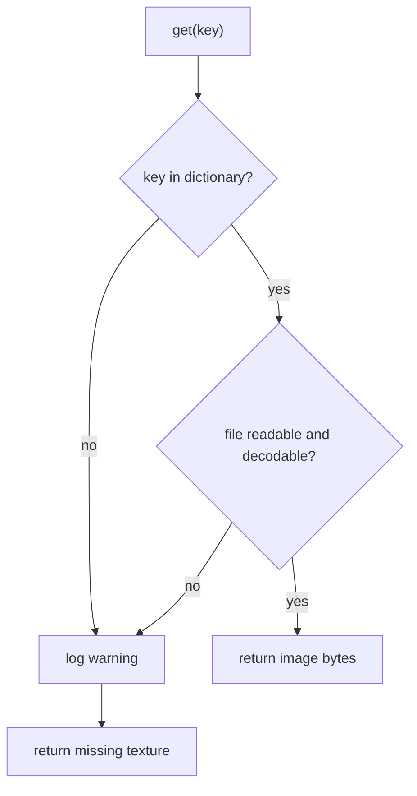
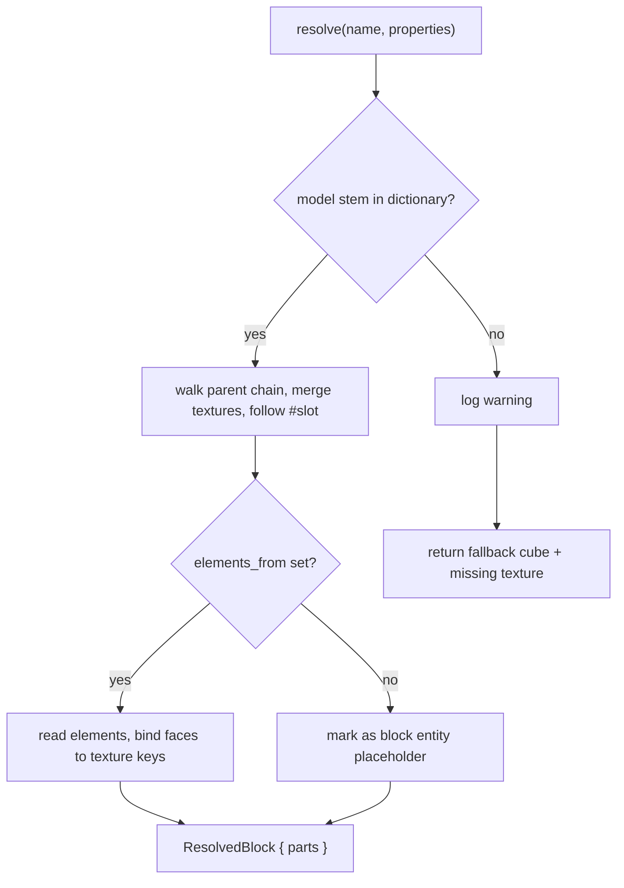
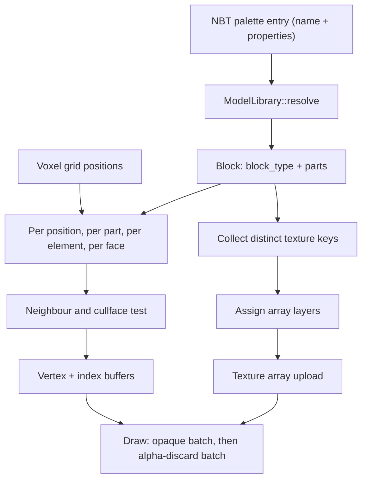

# Implementation Plan: Minecraft Create Mod NBT Editor

## Goal Description
Build a GUI application that enables reading, rendering, editing, and exporting Minecraft structure NBT files. The editor is written in Rust using `egui` for the UI shell and `wgpu` for 3D hardware-accelerated rendering.

---

## 1. System Architecture

The following diagram illustrates the flow of data from inputs (NBT files and Minecraft assets) to memory representation, rendering pipeline, and GUI controls.

```mermaid
graph TD
    subgraph Input Files
        NBT[".nbt Structure File"]
        Jar["Minecraft Client .jar / Asset Pack"]
    end

    subgraph Data Loading & Parsing
        NBT_P["NBT Parser (fastnbt)"]
        Asset_P["Asset Resolver (JSON models)"]
        Atlas_G["Texture Atlas Generator"]
    end

    subgraph Application Core State
        V_Grid["3D Voxel Grid (Spatial Map)"]
        E_State["Editor State (Tool, Palette, Selection)"]
    end

    subgraph Rendering Pipeline (wgpu)
        CPU_Cull["Rust-side CPU Face Culling"]
        GPU_Buf["GPU Vertex / Instance Buffers"]
        Render_P["Render Pass (Opaque & Grid)"]
        RT_Tex["Render Target Texture"]
    end


    NBT --> NBT_P
    Jar --> Asset_P
    Asset_P --> Atlas_G
    NBT_P --> V_Grid
    
    V_Grid --> CPU_Cull
    CPU_Cull --> GPU_Buf
    GPU_Buf --> Render_P
    Atlas_G --> Render_P
    
    Render_P --> RT_Tex
 
    E_State --> V_Grid
    V_Grid --> NBT
```

```mermaid
graph TD

    subgraph GUI (egui)
        Shell["egui UI Shell"]
        L_Sidebar["Left Sidebar: Tools"]
        R_Sidebar["Right Sidebar: Search & Properties"]
        B_Bar["Bottom Hotbar"]
        V_Port["Viewport Widget"]
    end

    Shell --> V_Port

```

---

## 2. Background: Underlying Data Models

To render and edit the structure, the editor bridges three distinct data layers:

```
+-----------------------------------------------------------------------------------+
| 1. NBT Structure Representation                                                   |
|    - Palette: List of Blockstate names + Properties (e.g. minecraft:lever[face=wall]) |
|    - Blocks: List of coordinates [x,y,z] + palette index + block entity data      |
+-----------------------------------------------------------------------------------+
                                         │
                                         ▼ (Resolved by)
+-----------------------------------------------------------------------------------+
| 2. Minecraft Asset Models                                                         |
|    - Models JSON: Hierarchical cuboid elements (coords 0-16) and texture variables |
|    - Looked up from the NBT palette name; properties stay on the palette entry    |
+-----------------------------------------------------------------------------------+
                                         │
                                         ▼ (Compiled into)
+-----------------------------------------------------------------------------------+
| 3. Render Mesh & Textures                                                         |
|    - Voxel Grid: 3D array of indices or references to the loaded block definitions|
|    - Texture Atlas: Stitched 2D sheet containing all resolved face textures       |
+-----------------------------------------------------------------------------------+
```

### 2.1. NBT Structure
A structure schematic is stored as an NBT compound:
*   **Size**: `[width, height, length]` defining the coordinate boundaries.
*   **Palette**: A list of compound tags defining blockstates (e.g., name, properties).
*   **Blocks**: A flat list of blocks, each having a relative position `pos` `[x, y, z]` and an index pointing to the palette.

### 2.2. Palette and Model JSONs
*   **Palette from NBT**: The list of existing blocks is the structure file's `Palette` (section 2.1). Each entry is a name plus properties (e.g. `minecraft:quartz_pillar` with `axis=y`). That list is produced by loading the NBT file; it has nothing to do with what is cached.
*   **Model Lookup**: The palette name's stem (`quartz_pillar`) is the key into the model cache. Cached files are model JSONs only.
*   **Model Composition**: Models define custom geometries via cuboids (`from`, `to`). If a model inherits from a `parent`, textures are merged down the chain. Palette properties stay on the block for the properties panel and for family-specific orientation (section 5.6).
*   **Atlas Stitched Coordinates**: To avoid bind-group switching overhead, all texture paths from the models are resolved, loaded, and compiled into a single texture atlas with mapped UV boundaries.

---

## 3. Texture Storage

Block textures are extracted from a Minecraft client `.jar` to an on-disk cache, indexed by a
JSON manifest, and read back on demand. Only the `.jar` is supported as an input source for now.

### 3.1. Extraction

The `.jar` is a zip archive. Entries are filtered on the path layout used by the client:

```
assets/{namespace}/textures/block/{file}.{png|bmp|jpg}
```

Each matching entry is written to `./texture_cache/` under its original file name. Entries with
any other extension are skipped. Extraction is a one-off import step, not part of startup.

### 3.2. Cache Layout

```
_textures.cache.json   # manifest: key -> texture record
texture_cache/
  stone.png
  glass.png
  ...
assets/
  image-missing.png    # static fallback, shipped with the app
```

The dictionary key is the file stem (file name without extension, e.g. `glass`). Every key maps
to exactly one file in `./texture_cache/`. `texture_cache/` and `_textures.cache.json` are gitignored.

### 3.3. Modules (`./src/textures/`)

| File | Responsibility |
| --- | --- |
| `mod.rs` | Module declarations and re-exports. |
| `texture.rs` | `Texture` record and `ImageFormat` enum. |
| `library.rs` | `TextureLibrary`: the dictionary, manifest load/save, and queries. |
| `jar.rs` | Jar scanning and extraction into `./texture_cache/`. |

A `Texture` is a reference to a cached file plus its metadata. It holds no pixel data:

```rust
pub enum ImageFormat { Png, Bmp, Jpg }

pub struct Texture {
    /// File name within `./texture_cache/`, including extension.
    file_name: String,
    format: ImageFormat,
    /// True if any pixel has an alpha value below 255.
    has_alpha: bool,
}
```

`has_alpha` is computed once at extraction time by decoding the image and scanning the alpha
channel. Formats that carry no alpha channel (`bmp`, `jpg`) are recorded as `false` without a
scan. The flag lets the renderer sort textures into opaque and alpha-discard draw batches
without re-decoding.

### 3.4. Manifest (`_textures.cache.json`)

`TextureLibrary` serialises the whole dictionary to `./_textures.cache.json` via
`serde_json` after an extraction run:

```json
{
  "stone": { "file_name": "stone.png",  "format": "png", "has_alpha": false },
  "glass": { "file_name": "glass.png",  "format": "png", "has_alpha": true }
}
```

### 3.5. Startup

1. The fallback image at the path given by `Config::missing_texture_path()`
   (`./assets/image-missing.png`) is decoded and held for the lifetime of the process. If it
   cannot be loaded, an error is logged; the application continues.
2. If `_textures.cache.json` exists it is deserialised into the in-memory dictionary. If it is absent
   or fails to parse, the dictionary starts empty and a jar import is required before textures
   resolve.

### 3.6. Query

`TextureLibrary::get(key)` returns decoded image bytes:



Both failure paths — key absent from the dictionary, and file absent or unreadable on disk —
log a warning and return the fallback image, so a caller always receives usable bytes. Decoded
images are memoised in the library so repeated queries do not re-read from disk.

### 3.7. Configuration

`Config` gains the texture paths:

*   `TEXTURES_MANIFEST_FILE` - `_textures.cache.json`
*   `texture_cache_dir()` - `./texture_cache`
*   `textures_manifest_path()` - `./_textures.cache.json`
*   `missing_texture_path()` - `./assets/image-missing.png`

### 3.8. Dependencies

`zip` (archive reading), `image` (decoding png/bmp/jpg and alpha inspection), `serde` +
`serde_json` (manifest), `log` (warnings and errors).

---

## 4. Model Storage

Block model JSONs are extracted from the same Minecraft client `.jar` to an on-disk cache, indexed
by a JSON manifest, and read back on demand. The layout mirrors section 3: same one-off import
step, same manifest-plus-files cache, same fall-back-and-warn query.

The cache holds only model JSONs, in a single folder. Existing blocks — the palette of
name-plus-properties pairs that a structure actually contains — come from the NBT file when it is
loaded (section 2.1). They are not enumerated from the cache, and Minecraft's blockstate JSONs are
not extracted or stored.

### 4.1. Extraction

Entries are filtered on the model path layout used by the client:

```
assets/{namespace}/models/block/{file}.json
```

Each matching entry is written to `./model_cache/` under its original file name. Entries with any
other extension are skipped, as are nested paths.

Both caches are filled by the same user action: the archive is opened once and every entry is
offered to the texture matcher and the model matcher in turn, so a client jar (tens of thousands
of entries) is walked a single time.

Extraction takes a second pass over the collected models to compute `elements_from` (section 4.3),
which depends on parent links that may point at entries not yet seen when the archive is walked in
storage order.

### 4.2. Cache Layout

```
_models.cache.json     # manifest: key -> model record
model_cache/
  cube_all.json
  cube_column.json
  quartz_pillar.json
  glass.json
  ...
```

The dictionary key is the file stem (e.g. `quartz_pillar`). Every key maps to exactly one file in
`./model_cache/`. `model_cache/` and `_models.cache.json` are gitignored.

Models refer to other assets by full id — `minecraft:block/cube_column` for a parent,
`minecraft:block/quartz_pillar_top` for a texture — always carrying a namespace and a `block/`
prefix that the file stem does not. Every such id is reduced to its stem at extraction time, the
same reduction that turns a texture reference into a `TextureLibrary` key (`quartz_pillar_top`).
Ids are therefore already normalised wherever they are stored, and no path munging happens at
lookup time.

### 4.3. Modules (`./src/block_models/`)

The module is named `block_models`, not `models`, because `./src/models/` already holds the CPU-side
data models (grid geometry, and the `Block` type of section 5). `block_models` deals only with
Minecraft's model JSON assets.

| File | Responsibility |
| --- | --- |
| `mod.rs` | Module declarations and re-exports. |
| `block_model.rs` | `BlockModel` manifest record. |
| `model_json.rs` | Serde types for a model JSON: `parent`, `textures`, `elements`, faces. |
| `library.rs` | `ModelLibrary`: the dictionary, manifest load/save, and resolution. |
| `jar.rs` | Jar scanning and extraction into `./model_cache/`. |

A `BlockModel` is a reference to a cached file plus everything needed to classify the model and find
its textures without opening it. It holds no geometry:

```rust
pub struct BlockModel {
    /// File name within `./model_cache/`, including extension.
    file_name: String,
    /// Stem of the `parent` model id, e.g. `cube_column`. `None` for root models.
    parent: Option<String>,
    /// Texture slot -> reference, exactly as the JSON declares it: either a
    /// `TextureLibrary` key (`quartz_pillar_top`) or a `#slot` indirection (`#all`).
    textures: BTreeMap<String, String>,
    /// Stem of the nearest model in the chain, possibly this one, that declares
    /// `elements`. `None` means the chain has no geometry at all.
    elements_from: Option<String>,
}
```

Every derived field is computed once at extraction time by parsing each JSON, the same way
`has_alpha` is computed by decoding each image. Model ancestors are shared across the whole
palette — every plain cube in a structure walks through `cube_all` — so keeping `parent` and
`textures` in the manifest means a chain is merged from memory instead of re-reading the same
ancestor once per descendant.

`elements_from` replaces a plain "has elements" flag because geometry is almost always inherited
rather than declared locally: it names the one file resolution has to open for a given model, and
`None` identifies the blocks that have no drawable geometry whatsoever (section 5.7).

Texture references are reduced to their stem on the way in, so a value is directly usable as a
`TextureLibrary` key. `#slot` indirections are stored verbatim, because they can only be followed
once a chain has been merged. A `BTreeMap` keeps slot order stable so re-running an import against
the same jar produces a byte-identical manifest.

### 4.4. Manifest (`_models.cache.json`)

`ModelLibrary` serialises the whole dictionary to `./_models.cache.json` via
`serde_json` after an extraction run:

```json
{
  "cube_all": {
    "file_name": "cube_all.json",
    "parent": "cube",
    "textures": {
      "down": "#all", "east": "#all", "north": "#all", "particle": "#all",
      "south": "#all", "up": "#all", "west": "#all"
    },
    "elements_from": "cube"
  },
  "quartz_pillar": {
    "file_name": "quartz_pillar.json",
    "parent": "cube_column",
    "textures": { "end": "quartz_pillar_top", "side": "quartz_pillar" },
    "elements_from": "cube"
  },
  "chest": {
    "file_name": "chest.json",
    "parent": null,
    "textures": { "particle": "oak_planks" },
    "elements_from": null
  }
}
```

`cube_all` shows why texture references are stored rather than looked up lazily: the slot names that
matter to the renderer (`down`, `up`, `east`, ...) live on the intermediate model and each points at
`#all`, which only the leaf model fills in. Both halves have to be present for a chain to resolve
from memory.

`chest` shows the other end of the range: no parent, no geometry anywhere, and a lone `particle`
texture. That is the signature of a block Minecraft draws with a hardcoded block-entity renderer,
and it is what section 5.7 keys the placeholder path off.

### 4.5. Startup

1. If `_models.cache.json` exists it is deserialised into the in-memory dictionary. If it is
   absent or fails to parse, the dictionary starts empty and a jar import is required before models
   resolve.
2. No fallback file is loaded from disk. An unresolvable model falls back to a synthetic full cube
   whose one texture slot is deliberately unresolvable, so the block draws with `TextureLibrary`'s
   missing texture on all six faces.

### 4.6. Query and Resolution

`resolve(name, properties)` turns one NBT palette entry into the geometry the mesh builder consumes.
The name's stem is looked up in the model dictionary. Properties travel with the result for the
properties panel and for family-specific orientation (section 5.6); they do not select a different
cached file.



For the selected model, the `parent` chain is walked upward:

*   Texture dictionaries are merged child-first; a child entry overrides its parent's entry for the
    same slot.
*   Values of the form `#slot` are indirections into the merged dictionary and are followed until
    they reach a real texture reference. An indirection that never resolves, or that loops, leaves
    the slot empty; `TextureLibrary` then supplies the missing texture for that face alone.
*   `elements_from` names the single file to read for geometry. Its elements are parsed and every
    face's texture reference is bound against the merged dictionary.
*   `elements_from: None` means the chain has no geometry. The part is marked as a block entity and
    takes the placeholder path in section 5.7 rather than being dropped.
*   A depth cap guards against parent cycles in a modified jar; exceeding it logs a warning and
    yields the fallback.

The result is a `ResolvedBlock { parts: Vec<ResolvedPart> }`, where each part holds its elements and
its orientation from the palette properties, with every texture value already a `TextureLibrary`
key. The common case is one part: the model named after the palette entry. Families that compose
several models add further parts. Resolved blocks are memoised per (name, properties) pair, as
decoded images are.

### 4.7. Configuration

`Config` gains the model paths, alongside the texture ones:

*   `MODELS_MANIFEST_FILE` - `_models.cache.json`
*   `model_cache_dir()` - `./model_cache`
*   `models_manifest_path()` - `./_models.cache.json`

### 4.8. Dependencies

No new crates. `zip` (archive reading), `serde` + `serde_json` (model JSONs and the manifest), and
`log` (warnings and errors) are already dependencies.

---

## 5. Drawing Blocks

How a resolved palette entry becomes triangles. A full cube is the common case and gets a dedicated
fast path, but it is only a minority of the block list: most blocks are an arbitrary set of boxes
with per-face texture rectangles, some of those boxes are rotated off-axis or flattened into planes,
a significant number are oriented by palette properties rather than the model, and a meaningful
fraction have no model geometry at all. This section covers all of those.

### 5.1. Types (`./src/models/`)

| File | Responsibility |
| --- | --- |
| `mod.rs` | Module declarations and re-exports. |
| `block.rs` | `Face`, `Block`, `BlockPart`, and the basic full-cube fast path. |
| `block_type.rs` | `BlockType`: the enum that links every family's own enum. |
| `element.rs` | `Element`, `ElementFace`, `ElementRotation`, `StateRotation`. |
| `mesh.rs` | `BlockVertex` and the emitter that turns parts into vertices and indices. |
| `grid.rs` | Reference grid and world axis geometry (existing). |

`block_type.rs` holds a single enum that links each recognised family, via that family's own enum, to
the general and degenerate cases. Families are an opt-in specialisation rather than a prerequisite
for drawing: `Elements` is the general path that handles anything with geometry, so a block is never
undrawable for want of a family. A family is worth adding when the editor gains something from
knowing the shape — a fast path, placement snapping, or a culling shortcut.

```rust
pub enum BlockType {
    /// Full cube from `cube_all` / `cube_column`. Fast path, skips element parsing.
    Basic(BasicBlock),
    // Slab(SlabBlock),
    // Stairs(StairsBlock),
    /// Anything else with geometry: drawn from the element list.
    Elements,
    /// No geometry anywhere in the model chain: Minecraft draws these with a
    /// hardcoded block-entity renderer we do not reimplement.
    BlockEntity,
    /// Deliberately draws nothing: air, barrier, structure void.
    Invisible,
}

impl BlockType {
    /// Classifies a resolved block. Families are tried first; anything with
    /// geometry that no family claims falls through to `Elements`.
    pub fn classify(name: &str, parent_stem: Option<&str>, has_geometry: bool) -> Self {
        if is_invisible(name) {
            return Self::Invisible;
        }
        if !has_geometry {
            return Self::BlockEntity;
        }
        match parent_stem.and_then(BasicBlock::from_parent) {
            Some(basic) => Self::Basic(basic),
            None => Self::Elements,
        }
    }
}
```

The order matters: the two degenerate cases are decided first, then families get a chance to claim
the block, and `Elements` catches the remainder. Adding a family can only ever move a block off the
general path, never leave it undrawn.

A `Block` is one NBT palette entry. Its geometry is a list of parts. The common case is a single
part from the model named after the palette entry; families that compose several models add more:

```rust
pub struct Block {
    /// Blockstate name from the NBT palette, e.g. `minecraft:quartz_pillar`.
    name: String,
    /// Properties parsed off the palette name, e.g. `axis` -> `y`.
    properties: BTreeMap<String, String>,
    block_type: BlockType,
    /// One entry for the named model; families may add more.
    parts: Vec<BlockPart>,
    /// The chain's `particle` texture. Drives the palette icon and the
    /// placeholder cube for `BlockEntity`.
    particle_texture: Option<String>,
}

pub struct BlockPart {
    /// Model stem this part resolved to, e.g. `quartz_pillar_horizontal`.
    model: String,
    elements: Vec<Element>,
    /// Orientation from the palette properties, in 90 degree steps.
    rotation: StateRotation,
    /// Keep UVs fixed in world space when `rotation` is applied.
    uvlock: bool,
}
```

`name` is stored rather than derived: it is the identity used by the palette, the search sidebar,
the properties panel, and NBT export, and no model stem reproduces it. Note that textures are *not*
held on the block — a texture reference is a property of an individual element face (section 5.4),
because the UV rectangle, UV rotation and tint that go with it are per-face. `particle_texture` is
the one exception, kept because it is the only sensible whole-block texture.

### 5.2. Coordinate and Winding Conventions

| Face | Axis | Plane at cube bounds |
| --- | --- | --- |
| `Down` | -Y | `y = 0` |
| `Up` | +Y | `y = 1` |
| `North` | -Z | `z = 0` |
| `South` | +Z | `z = 1` |
| `West` | -X | `x = 0` |
| `East` | +X | `x = 1` |

One block is one world unit, matching the grid in `grid.rs`. A block stored at NBT position
`[x, y, z]` occupies `[x, x+1] x [y, y+1] x [z, z+1]`; its origin is the min corner.

Model JSON coordinates are on a 0-16 scale, so positions divide by 16 on the way in. The scale
permits values from -16 to 32, so an element may legitimately stick out past its own block. Nothing
may assume a block's mesh is contained by its cell: selection and raycast bounds come from the union
of the element bounds, not from the cell.

Corners are wound counter-clockwise as seen from outside, so `cull_mode: Back` discards faces seen
from behind. UVs put `v = 0` at the *top* of the texture, following Minecraft's convention rather
than wgpu's.

### 5.3. Block Type: Basic

The fast path: one element spanning the whole cube, six faces, full-texture UVs, no rotation and no
tint. Two members, distinguished only by how the model spreads its texture slots over the faces:

| `BasicBlock` | Parent model | `down` / `up` | `north` / `south` / `west` / `east` |
| --- | --- | --- | --- |
| `All` | `cube_all` | `all` | `all` |
| `Column` | `cube_column` | `end` | `side` |

```rust
pub enum BasicBlock { All, Column }

impl BasicBlock {
    pub fn from_parent(stem: &str) -> Option<Self>;
    /// Texture slot this member reads for `face`.
    pub fn slot(self, face: Face) -> &'static str;
}
```

Geometry is a compile-time table: six faces, four corners each, as position plus UV in the unit
cube. This is the whole definition of the shape.

```rust
/// Four corners of (x, y, z, u, v) per face, counter-clockwise from outside.
const FACE_CORNERS: [(Face, [[f32; 5]; 4]); 6] = [
    (Face::West,  [[0.,0.,0., 1.,1.], [0.,0.,1., 0.,1.], [0.,1.,1., 0.,0.], [0.,1.,0., 1.,0.]]),
    (Face::East,  [[1.,0.,1., 1.,1.], [1.,0.,0., 0.,1.], [1.,1.,0., 0.,0.], [1.,1.,1., 1.,0.]]),
    (Face::Down,  [[0.,0.,0., 0.,1.], [1.,0.,0., 1.,1.], [1.,0.,1., 1.,0.], [0.,0.,1., 0.,0.]]),
    (Face::Up,    [[0.,1.,1., 0.,1.], [1.,1.,1., 1.,1.], [1.,1.,0., 1.,0.], [0.,1.,0., 0.,0.]]),
    (Face::North, [[1.,0.,0., 0.,1.], [0.,0.,0., 1.,1.], [0.,1.,0., 1.,0.], [1.,1.,0., 0.,0.]]),
    (Face::South, [[0.,0.,1., 0.,1.], [1.,0.,1., 1.,1.], [1.,1.,1., 1.,0.], [0.,1.,1., 0.,0.]]),
];
```

Drawing one block appends, per face, the four corners translated by the block origin and tagged with
the texture array layer for that face's slot, then the quad's two triangles
`(base, base+1, base+2, base, base+2, base+3)`. A full cube is 24 vertices and 36 indices.

Note that a block being cube-shaped does not make it a `Basic`: `quartz_pillar` on `axis=x` is
oriented by its palette properties and takes the section 5.6 path.

### 5.4. Elements: The General Case

An element is one box in model space with up to six independently described faces.

```rust
pub struct Element {
    /// Model space, 0-16 per axis, permitted range -16..32.
    from: Vec3,
    /// Equal to `from` on an axis means a zero-thickness plane, not a box.
    to: Vec3,
    rotation: Option<ElementRotation>,
    /// `None` means the face is not drawn at all.
    faces: [Option<ElementFace>; 6],
    /// Minecraft's per-element diffuse shading toggle.
    shade: bool,
}

pub struct ElementRotation {
    /// Pivot in model space.
    origin: Vec3,
    /// Exactly one axis.
    axis: Axis,
    /// One of -45, -22.5, 0, 22.5, 45 degrees.
    angle: f32,
    /// Scale out to fill the rotated bounding box.
    rescale: bool,
}
```

Three consequences of this shape are worth calling out, because each one breaks an assumption that
"a list of boxes with sizes" would invite:

**Elements are not always axis-aligned.** A single-axis rotation of up to 45 degrees about an
arbitrary origin is common — every cross-shaped plant, every raised rail. Vertices must therefore be
rotated about `origin` before the block origin is applied. `rescale` additionally scales the element
by `1 / cos(angle)` on the two axes perpendicular to the rotation axis, which is what lets a plant's
45-degree planes span the full width of the block instead of falling short.

**Zero-thickness elements are planes.** When `from` and `to` are equal on an axis, four of the six
faces collapse to zero area and are simply not emitted. The two surviving opposite faces sit in the
same plane with opposite winding, so a plane declaring both is visible from either side with normal
back-face culling still enabled. No double-sided pipeline or second draw mode is needed.

**Faces are optional.** Most elements declare fewer than six. An absent face is not a face with a
missing texture; it is not drawn, and it must not be given a placeholder.

### 5.5. Faces

```rust
pub struct ElementFace {
    /// `TextureLibrary` key, bound from the model's merged texture dictionary.
    texture: String,
    /// Sub-rectangle of the texture as [u1, v1, u2, v2] on the same 0-16 scale.
    /// Defaults to the element's bounds projected onto this face.
    uv: [f32; 4],
    /// 0, 90, 180 or 270. Rotates the UV rectangle within the face.
    uv_rotation: u16,
    /// The neighbour direction that is allowed to cull this face.
    cullface: Option<Face>,
    /// Selects a tint multiplier; `None` is untinted.
    tint_index: Option<u8>,
}
```

The `uv` default matters: when a face omits `uv`, the rectangle is the element's own bounds
projected onto that face, which is how a small box picks up the correct patch of a 16x16 texture
without stating it. A rectangle may also be given *reversed* (`u1 > u2`) to mirror the texture, so
the values must never be sorted or normalised into a min/max pair.

Tinting has no biome to consult in a structure editor, so `tint_index` resolves through a fixed
table keyed by block name — one foliage green, one grass green, one water blue, redstone by power
level — defaulting to white. The result is a per-vertex colour multiplier.

Minecraft's fixed directional shading is folded into that same multiplier rather than computed in
the shader: `Down` 0.5, `Up` 1.0, `North` and `South` 0.8, `West` and `East` 0.6, or 1.0 throughout
when the element sets `shade: false`. Folding it in at mesh build time keeps the vertex small and
the shader trivial.

```rust
#[repr(C)]
#[derive(Clone, Copy, bytemuck::Pod, bytemuck::Zeroable)]
pub struct BlockVertex {
    pub position: [f32; 3],
    pub uv: [f32; 2],
    /// Layer index into the block texture array.
    pub layer: u32,
    /// Tint multiplied by directional shading. White when untinted and unshaded.
    pub color: [u8; 4],
}
```

### 5.6. Palette Property Transforms

Rotation derived from the NBT palette properties rather than the model is what orients logs, stairs,
furnaces and fence arms, and it is invisible to `BlockModel`. Each part carries it:

```rust
pub struct StateRotation {
    /// Degrees about X, one of 0, 90, 180, 270.
    x: u16,
    /// Degrees about Y, one of 0, 90, 180, 270.
    y: u16,
}
```

The transform is applied about the centre of the block, `(8, 8, 8)` in model space, X first and then
Y, after any element rotation and before the translation to the block's world position.

Two details are easy to miss. First, `uvlock` counter-rotates each affected face's UV rectangle so
the texture stays aligned to world axes instead of turning with the geometry; without it the tops of
rotated stairs and fence gates visibly spin. Second, a rotation permutes face directions, so a
`cullface` of `north` on a part rotated `y = 90` culls against the neighbour to the *east*. Culling
must use the rotated direction, or faces disappear against the wrong neighbours.

### 5.7. Blocks Without Geometry

A part whose model chain has no `elements_from` cannot be drawn from assets, because upstream it is
drawn by a hardcoded Java renderer with its own entity models: every sign, banner, bed, chest,
shulker box, head, conduit, decorated pot and bell. Fluids are in the same position, since water and
lava generate their surface from neighbouring fluid levels rather than from a model. In a Create
schematic editor this bucket also covers Create's own instanced-rendering blocks, such as belts and
pipes.

These are split by intent rather than lumped together:

*   `BlockType::Invisible` for blocks that genuinely draw nothing — air, cave air, void air, barrier,
    structure void, light. Recognised from a fixed name list and skipped entirely.
*   `BlockType::BlockEntity` for everything else with no geometry. The part draws a full cube using
    the chain's `particle` texture, which is present on exactly these models and is chosen upstream
    to be representative — `chest` gives `oak_planks`. The cube is inset slightly so it reads as a
    stand-in rather than a solid block, and the type is surfaced in the UI so the properties panel
    can still show the block entity's NBT and the sidebar can mark it as approximated.

Drawing a recognisable placeholder matters more than it sounds: chests and signs are common enough
in schematics that silently dropping them would leave visible holes in an otherwise correct render.

### 5.8. Textures on the GPU

Block textures are uniformly 16x16, so they are uploaded as a **2D texture array** with one layer per
distinct texture, rather than stitched into a single atlas. Per-face UV rectangles then normalise
into `[0, 1]` against a whole layer, with no atlas offset arithmetic, no padding, and no half-texel
inset against bleeding between neighbours. This supersedes the atlas note in section 2.2.

Mesh building starts by collecting the distinct texture keys the structure needs, assigning each an
array layer, and asking `TextureLibrary::get` for its pixels. Keys that fail to resolve return the
missing texture, so every layer is populated and no face is skipped for want of one. Textures whose
`Texture::has_alpha` flag is set are drawn in a second, alpha-discard batch after the opaque one.
Textures taller than they are wide are animation strips; the first frame is used and the rest are
ignored.

### 5.9. Mesh Assembly



Positions are grouped by palette index so a block resolves once and its parts, layers and per-face
tables are reused for every instance in the structure.

### 5.10. Face Culling

Two independent mechanisms, both needed:

*   **Back-face culling** on the GPU, from consistent counter-clockwise winding. Free, and enough to
    make zero-thickness planes work as described in 5.4.
*   **Neighbour culling** in the mesh builder. A face is a candidate only if it declares a
    `cullface`; faces without one are always drawn. A candidate is skipped when the neighbour in
    that direction — rotated per 5.6 — fully covers the shared face and is opaque.

`BlockType` answers the neighbour question on behalf of the block: `covers_full_face(face)` and
`is_opaque()`. `Basic` answers `true` and `!has_alpha` outright; `Elements` computes it once at
resolve time by checking whether any element spans the full 0-16 square on that side with an opaque
texture; `BlockEntity` and `Invisible` answer `false` so neighbours around them keep their faces.

The first implementation may emit every face and rely on back-face culling alone. Neighbour culling
is a pure optimisation and can land later without changing the geometry.

### 5.11. Adding a Block Type

A block with geometry already draws through `Elements`, so this is only for adding a specialisation.

1. Add `./src/models/<family>.rs` with the family's enum, its parent-model mapping, and its corner
   table or geometry emitter.
2. Add a variant to `BlockType` wrapping that enum, and extend `BlockType::classify` so it is
   claimed before falling through to `Elements`.
3. Extend the `BlockType` dispatch for face emission, `covers_full_face`, and `is_opaque`.
4. Note any palette properties the family needs (facing, half, shape, axis) so the properties
   panel and orientation (section 5.6) handle them.
5. Add a `Block Type:` subsection alongside 5.3 recording the parent models covered and the
   slot-to-face table.
6. Confirm the family renders identically before and after: `Elements` is the reference
   implementation, and a specialisation that disagrees with it is a bug in the specialisation.

---

## 6. Block Placement

Default placement puts a single block in its default position: the palette entry as selected, with
no extra facing or axis derived from the click. The placement target is a face — a cell of the
ground grid, or an exposed face of an existing block — and the new block occupies the empty cell
adjacent to that face, on the outside of the hit.

Later placement modes (oriented families, lines, cuboids, and other shapes) belong in further
subsections here. This section currently covers only the single-block case.

### 6.1. Single Block Placement

Raycasting from the cursor (section 7, Phase 2) resolves the nearest hit to a face: either a ground
grid cell or a face on an already-placed block. That face is the attachment surface.

*   **Target highlight.** The hit face is highlighted while it is the placement target, including at
    the moment of placement, so it is obvious which grid cell or block boundary the new block will
    sit against.
*   **Cell.** The new block occupies the empty neighbour on the outward side of the highlighted
    face. A hit on the ground grid places at that cell; a hit on another block places in the cell
    sharing that face.
*   **Default state.** The placed block is the current palette selection in its default orientation.
    Hit-face orientation, snapping, and multi-block shapes are out of scope for this subsection.

---

## 7. High-Level Implementation Plan

The implementation is broken down into four key phases, moving from initial validation to final integration:

### Phase 1: Core Data Engine (Rust)
Set up the backend storage, asset loader, and file parser in Rust.
*   **NBT Serialization**: Parse and export `.nbt` structures via `fastnbt`.
*   **Asset Processing**: Import client assets into the texture and model caches (sections 3 and 4), resolve NBT palette entries against cached model parent hierarchies into element geometry (section 5), and build the block texture array.
*   **Spatial Representation**: Construct an in-memory 3D sparse grid that allows fast lookups for culling and editing.

### Phase 2: Rust wgpu Rendering Port
Port the rendering architecture to Rust.
*   **GPU Pipeline**: Create vertex buffers, texture binding groups, uniform buffers, and render pipelines.
*   **Voxel Mesh Builder**: Translate the CPU culling logic to Rust. Construct meshes dynamically from the spatial grid.
*   **Interactivity Pass**: Handle mouse-to-world raycasting to highlight block faces and grid lines.

### Phase 3: GUI Shell & Editor Operations (egui)
Build the user interface and implement editing tools.
*   **egui Integration**: Render the wgpu canvas to an off-screen texture and embed it in egui.
*   **Layout Panels**: Create the tool sidebars, search palette, block details window, and bottom hotbar.
*   **Editor Commands**: Implement single-block default placement (section 6.1), translation, rotation, deletion, selection, and procedural shape placement (lines, cuboids, cylinders).
